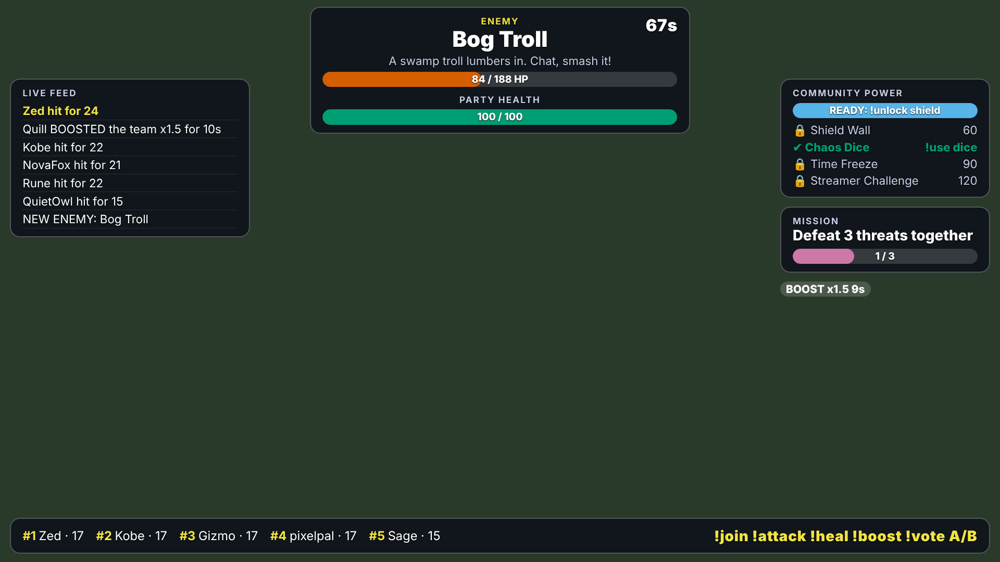

# ChatRaid - turn Twitch chat into a game engine

ChatRaid is a real-time, AI-driven game that a Twitch chat plays together. An **AI Director** reads chat
(volume, mood, hype, spam), then spawns enemies, quests, hazards and twists. Viewers fight with
`!attack`, `!heal`, `!boost`, `!vote A/B`, earn points, and unlock **community abilities**. An OBS
**overlay** shows the live world and the consequences of chat's actions; a **dashboard** gives the streamer
full control (pause, skip, difficulty, blocklist, kill switch).



## Quick start (no Twitch account needed)

```bash
pip install -r requirements.txt
CHATRAID_DEMO=1 python -m chatraid
```

The console prints two URLs:

- **Dashboard** `http://localhost:8000/dashboard#<admin token>`
- **OBS overlay** `http://localhost:8000/overlay?token=<overlay token>`

Demo mode starts a session and fills chat with simulated viewers (hype bursts, quiet spells, spam and
prompt-injection attempts), so the whole game is alive within seconds. Open the overlay in a browser tab
to watch it.

## Run on a real Twitch channel

1. Create an app at <https://dev.twitch.tv/console>, set the redirect URI to
   `http://localhost:8000/auth/twitch/callback`.
2. `cp .env.example .env` and fill in `TWITCH_CLIENT_ID`, `TWITCH_CLIENT_SECRET`, `TWITCH_CHANNEL`,
   `CHATRAID_ADMIN_TOKEN`. Optionally `OPENAI_API_KEY` (AI Director) and `TWITCH_BOT_NICK` /
   `TWITCH_BOT_TOKEN` (so the bot can talk in chat).
3. `set -a; source .env; set +a; python -m chatraid`
4. Visit `/auth/twitch/login` once to authorise EventSub (follows, subs, raids, channel-point redemptions).
   Tokens are stored encrypted (Fernet). Restart so EventSub connects.
5. In OBS add a **Browser Source** (1920x1080) with the overlay URL from the dashboard.
6. Open the dashboard, pick a theme and difficulty, press **Start session**.

Without `OPENAI_API_KEY` the Director uses its template library, which is fully playable. With a key it
asks the model for a structured `EventProposal` (4 s timeout, validated, falls back on any failure).

## How it plays

| Phase | What happens |
| --- | --- |
| Idle | Chat is invited to `!join [warrior\|healer\|trickster]` |
| Event | Director picks a type from chat signals: hype -> enemy, quiet -> quest, hurt party -> hazard, predictable -> twist, spam -> vote |
| Action | `!attack` (damage), `!heal` (party HP), `!boost` (x1.5 for 10 s), `!vote A/B` |
| Resolution | Win/lose changes world state, awards points, advances the shared mission |
| Adaptation | Win streak -> harder (up to +2), losing streak -> easier; last event types are not repeated |

Community abilities (`!unlock <key>` with shared power, then `!use <key>`): **Shield Wall** (blocks the next
hit), **Chaos Dice**, **Time Freeze** (20 s), **Streamer Challenge** (a timed rule that only takes effect if
the streamer clicks *Accept* in the dashboard). `!me` shows your stats, `!forgetme` deletes your data.

## Architecture

```
Twitch chat (IRC) + EventSub (WS) -> Gateway -> on_chat / on_twitch_event
                                       |-> ChatAnalyzer -> ChatPulse -> Director -> SafetyFilter -> GameEngine
                                       '-> GameEngine (commands, cooldowns, abilities, ticks)
GameEngine -> Realtime (WebSocket) -> OBS overlay (/ws/overlay/{token}) + dashboard (/ws/dashboard)
GameEngine / Director -> SQLite (players, world, events, action log, pulses, feedback)
```

Safety is layered: viewer input and every AI output pass a filter (blocklist, prompt-injection patterns,
PII, URLs); chat is given to the LLM only as quoted, untrusted data; proposals are schema-validated and
difficulty-clamped in code; the overlay renders user text with `textContent` only; the overlay URL token is
revocable; the dashboard needs an admin token; and the kill switch clears everything instantly.

## Tests

```bash
pip install -r requirements-dev.txt
pytest -q          # 56 tests (SQLite runs in WAL mode; the 300-message burst test passes on Windows too): engine, safety, analyzer, director (mock LLM), gateway parsing, API/WS, load
ruff check .
```

Covered: command parsing and rules with a fake clock, cooldowns, abilities, persistence across restarts,
prompt-injection and unsafe-output rejection, LLM timeout/error/invalid-JSON fallback, adaptive difficulty,
anti-repetition, OAuth state check and encrypted token storage, EventSub signature verification, overlay
token revocation, and a 500-chatter / 100 msg/s burst plus the channel throttle.

Fake traffic against a running server: `python -m chatraid.simulator --token <admin> --scenario hype`
(scenarios: mixed, hype, quiet, spam, injection).

## Status and known gaps (read before the demo)

Verified offline: everything above, plus the running server, overlay and dashboard in a real browser
against the simulator. Verified live on a real Twitch channel (Nov 2, 2026): IRC chat connection,
`!join`/`!attack`/`!heal` commands, points, quests from the Director, overlay and dashboard updates.

**Not verified against live services:** EventSub subscriptions (follow/sub/raid/redemptions), the full OAuth
round trip, and the OpenAI call (the demo runs the template Director). The parsers and
signature/OAuth-state logic are unit-tested, but do a real test stream before relying on them.

Deviations from the design doc, chosen to keep dependencies small:
- `sqlite3` from the standard library instead of SQLAlchemy + Alembic (schema is plain SQL, easy to port).
- A small custom IRC/EventSub client (`gateway.py`) instead of the `twitchAPI` library.
- Director tools (`get_chat_pulse`, `get_game_state`, ...) exist in code and are executed by the Director
  to build the prompt; the model does not drive a function-calling loop.
- Chat sentiment/hype use a lexicon + rate heuristics rather than a small LLM classifier.
- Not done: Playwright UI tests, Locust load test, Twitch Extension (FR15), mypy pass, post-stream recap
  agent (a JSON recap endpoint exists).

## Layout

`chatraid/` engine, director, safety, analyzer, gateway, runtime, app, storage, auth, simulator, `static/`
(overlay + dashboard). `tests/` pytest suite. `docs/DEMO.md` 3-minute demo script,
`docs/SUBMISSION.md` Devpost text. `AGENTS.md` instructions for coding agents.
